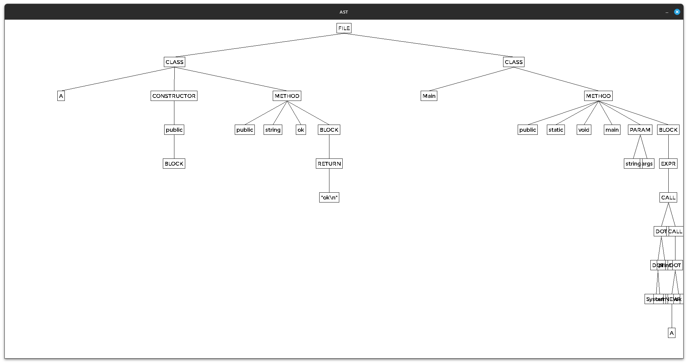
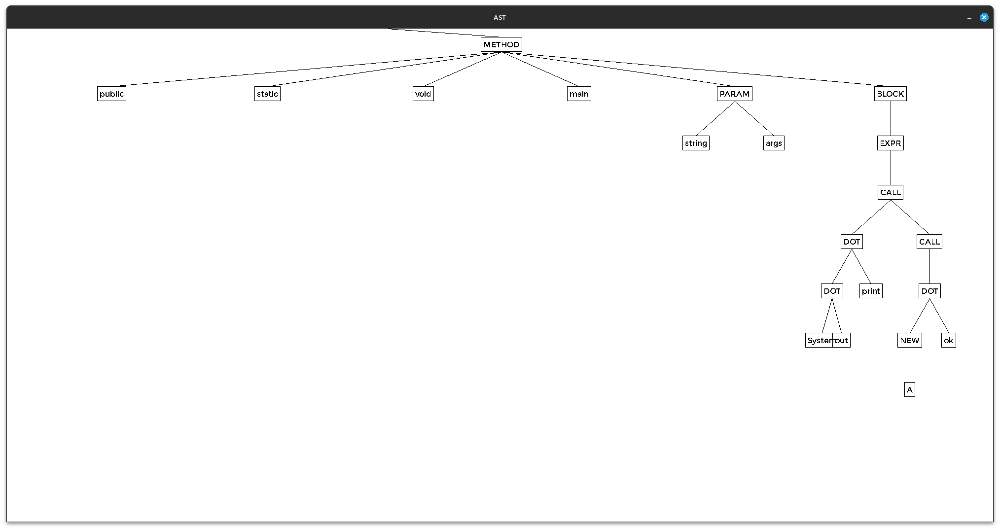
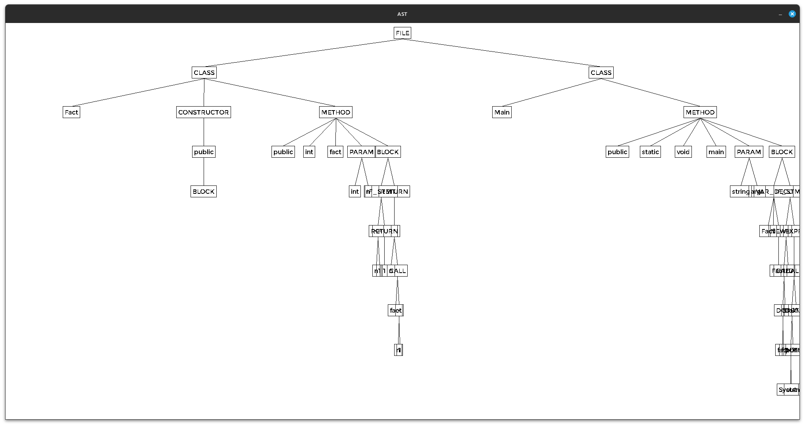
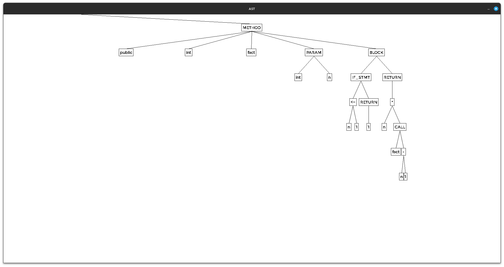
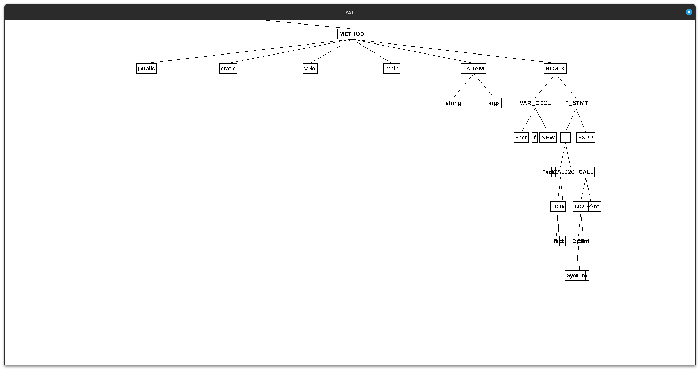
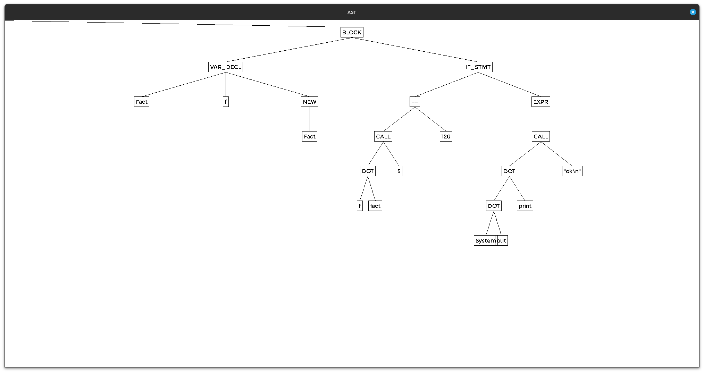

# Rapport d'activité - FISE Groupe 10
- Anaé DESIGAUX
- Hugo DARTOY
- Noah ANDRIAMAMPIANINA
- Paul-Alexandre DEGUILHEN

## Sommaire
  - [Grammaire](#grammaire)
  - [Lexer](#lexer)
  - [Parser V1](#parser-v1)
  - [Parser V2](#parser-v2)
  - [Structure AST](#structure-ast)
  - [Affichage SDL AST](#affichage-sdl-ast)
  - [Difficultés rencontrées](#difficultés-rencontrées)
  - [Exemples](#exemples)
  - [Répartition du travail](#répartition-du-travail)

## Grammaire

Voir annexe [Grammaire](./grammar.txt)

## Lexer
Le lexer est construit en deux parties : une partie qui reconnaît les opérateurs (+, - , &&,...) et une autre qui lit les chaînes de caractères et reconnaît les expressions réservées (if, else, class, for,...).
## Parser V1

Version avec stack des NUT, en reprenant la table SD avec des actions sémantiques dans chacune des cases valides.\
Problème rencontré : impossible de stocker le nom d’une variable ou d’une classe par exemple, ce qui rend la construction des AST impossible.

## Parser V2

Ecrire une fonction de parsing par règle => fonctions imbriquées.\
Squelette d'une fonction pour la règle classe :
```
classe -> public_opt static_opt "class" "ident_type" extends_opt "{" decl_list "}" .
parse_classe():
    pub = parse_public()
    stat = parse_static()
    match("class")
    class_name = match(id)
    extended_class = parse_extends_opt()
    match("{")
    declarations = parse_decl_list()
    match("}")
```

En cas de rencontre d'erreur syntaxique, le parser utilise la méthode panicmode :\
le lexer avance jusqu'au prochain `;`ou `}` ou `{`, puis continue le parsing à cet endroit.

## Structure AST

Voir annexe [Structure AST](./ast.md)

## TypeChecker (Analyse sémantique)

Parcours de l’AST construit pour relever les erreurs sémantiques de type.

## Affichage SDL AST

Affichage dans une fenêtre SDL de l’AST construit. Possibilité de naviguer dans l’arbre avec les flèches du clavier ou avec la souris et de zoomer/dézoomer avec la molette. Réinitialiser la vue avec la touche R.

## Difficultés rencontrées

- Rendre la grammaire LL(1) : factorisations, récursivités gauches… conflits à gérer => timing serré
- Première implémentation du parser incompatible avec la construction des AST
- Panicmode : conflits ponctuels dans plusieurs fonctions parse_X() lorsque le panicmode s'active. Le Lexeur avance par exemple à un `;` alors que la prochaine ligne de la fonction parse_X() doit lire `)`.
Entre autres, il était complexe de trouver une méthode qui marche pour chacune des fonctions parse_X()    

## Exemples

### Exemple 1

#### Programme JURA

```java
class A {
    A() {}
    String ok() { return "ok\n"; }
}
class Main {
    public static void main(String args[]) {
        System.out.print(new A().ok());
    }
}
```

#### AST affiché




### Exemple 2

#### Programme JURA

```java
class Fact {
    Fact() {}
    int fact_rec(int n) {
        if (n <= 1) return 1;
        return n * fact_rec(n - 1);
    }
}
class Main {
    public static void main(String args[]) {
        Fact f = new Fact();
        if (f.fact_rec(5) == 120)
            System.out.print("ok\n");
    }
}
```

#### AST affiché






## Répartition du travail

Voir annexe [Répartition du travail](./repartition.md)